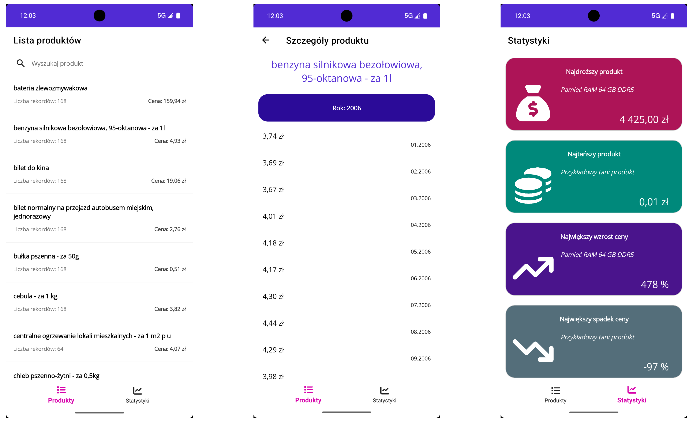
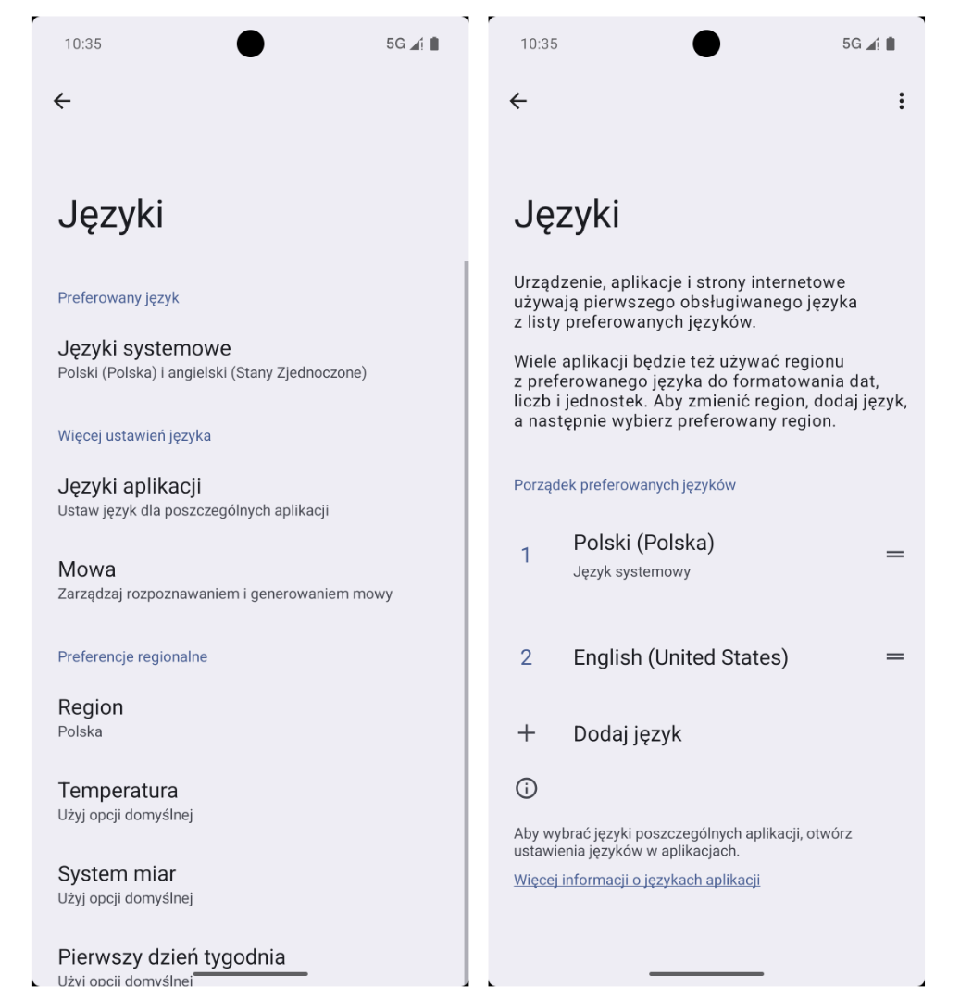
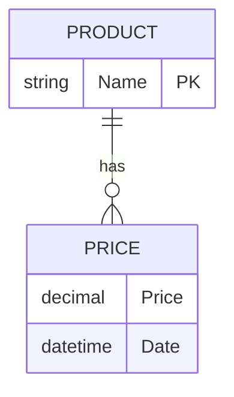

# Task 19 - Ceny towarów konsumpcyjnych i usług w Polsce
Prosta aplikacja mobilna pozwalająca użytkownikowi na wgląd w zmiany cen towarów konsumpcyjnych w Polsce w latach 2006 - 2019


## Wymagania

Twoja aplikacja powinna spełniać następujące kryteria:
 - ceny towarów konsumpcyjnych powinny być ładowane przy starcie aplikacji z jej zasobów - `Resources`,
 - użytkownik powinien mieć możliwość przejrzenia wszystkich towarów konsumpcyjnych (*posortowanych alfabetycznie*) obecnych w zestawieniu, na ekranie głównym aplikacji:
    - nazwę towaru (*czcionka pogrubiona*),
    - liczbę rekordów z cenami danego towaru (*kolor `Gray500`, rozmiar czcionki 12*),
    - najnowszą znaną cenę danego produktu w formacie `Cena: {cena} zł` (*kolor `Gray600`, czionka: pogrubiona, rozmiar 12*),
    - poszczególne rekordy powinny być oddzielone subtelnymi liniami w kolorze `Gray100` - można to uzyskać poprzez ustawienie koloru tła dla `<CollectionView />`
 - po kliknięciu w towar na liście, użytkownik jest przenoszony na stronę z wszystkimi cenami historycznymi danego towaru:
    - na stronie jest etykieta z nazwą towaru (*kolor `Primary`, rozmiar czcionki Large, tekst wyśrodkowany, padding 10*),
    - znajduje się tutaj również przewijana lista z wszystkimi historycznymi cenami danego towaru, posortowana po dacie pomiaru ceny towaru (na górze listy najstarsze, na dole - najnowsze pomiary), pogrupowana latami pomiarów cen,
    - nagłówek grupy na liście powinien być lekko zaokrąglony (20), posiadać padding (10 pionowo, 20 poziomo) oraz margines 10, kolor tła `Tertiary` oraz etykietę, która będzie wyświetlała tekst `Rok: {rok}` - pogrubiony, wyśrodkowany w kolorze `White`,
    - każdy rekord z ceną na liście powinien:
        - wyświetlać cenę zaczynając od lewej krawędzi, rozmiar czcionki 16,
        - wyświetlać datę pomiaru ceny w formacie `MM.yyyy` przy prawej krawędzi, rozmiar czcionki 12,
 - użytkownik może filtrować elementy na liście przy użyciu kontrolki `<SearchBar />`:
    - wyszukiwanie produktu nie powinno być czułe na rozmiar czcionki,
    - wyszukiwarka filtruje listę na żywo (bez konieczności zatwierdzania kliknięciem),
    - towary powinny być filtrowane na podstawie tego, czy ich nazwa zawiera w sobie wyszukiwaną frazę,
 - aplikacja jest podzielona na dwie zakładki:
    - Produkty - z listą towarów,
    - Statystyki - z wskazanymi statystykami obliczonymi na podstawie posiadanych danych,
 - na ekranie ze statystykami, użytkownik powinien zobaczyć 4 prostokąty (*zaokrąglenie krawędzi 20*):
    - najdroższy towar w zestawieniu (*jego ostatnia znana cena*), kolor `#AD1457`,
    - najtańszy towar w zestawieniu (*jego ostatnia znana cena*), kolor `#00897B`,
    - największy wzrost ceny (*procentowo, między najstarszą a najnowszą ceną*), kolor `#4A148C`,
    - największy spadek ceny (*procentowo, między najstarszą a najnowszą ceną*), kolor `#546E7A`,
    - jeżeli na kafelku statystyk jest wyświetlana cena, powinna ona być w formacie `{cena} zł`,
    - jeżeli na kafelku statystyk jest wyświetlana wartość procentowa, powinna być wyświetlana w formacie `{liczba} %`
    - ekran ze statystykami powinien być **maksymalnie podobny**, do przedstawionego na powyższym obrazku,
 - wszystkie ceny (*niezależnie od ekranu aplikacji*) powinny być wyświetlane w formacie, który:
    - używa `,` jako separator ułamkowy,
    - używa spacji jako seperator dziesiętny (*odstęp po 3 cyfrach dziesiętnych*),
    - zawsze posiada dokładnie dwa miejsca po przecinku.

**W przypadku tego zadania nie masz swobody w implementacji interfejsu użytkownika**, musi być on maksymalnie podobny do tego, który jest widoczny na poglądowych obrazkach. Zastosuj się do wszystkich wymagań oraz popraw swój interfejs w taki sposób, aby przypominała maksymalnie ten z obrazków.

**Pliki niezbędne do wykonania zadania** znajdziesz w katalogu `assets/` w tym repozytorium - są tam zarówno dane jak i wykorzystane obrazki.

## Wskazówki
Poniżej znajdziesz kilka wskazówek, które pomogą Ci w realizacji projektu.

### Formatowanie liczb
.NET posiada wbudowane metody do formatowania liczb. Metody formatujące są bardzo dopracowane oraz **uniwersalne** - co może stwarzać nam pewnego rodzaju problem, *ale o tym za chwilę*.

O tym, że możemy formatować liczby poprzez metodę `.ToString()` na danym obiekcie, już wiesz. Nigdy jednak nie zagłebialiśmy się w szczegóły takiego formatowania.

| Format specifier | Name | Description | Examples |
| --- | --- | --- | --- |
| "B" or "b" | Binary | Result: A binary string. Supported by: Integral types only (.NET 8+). Precision specifier: Number of digits in the result string. More information: The Binary ("B") Format Specifier. | 42 ("B")-&gt; 101010 255 ("b16")-&gt; 0000000011111111 |
| "C" or "c" | Currency | Result: A currency value. Supported by: All numeric types. Precision specifier: Number of decimal digits. Default precision specifier: Defined by [NumberFormatInfo.CurrencyDecimalDigits](/en-us/dotnet/api/system.globalization.numberformatinfo.currencydecimaldigits). More information: The Currency ("C") Format Specifier. | 123.456 ("C", en-US)-&gt; \$123.46 123.456 ("C", fr-FR)-&gt; 123,46 € 123.456 ("C", ja-JP)-&gt; ¥123 -123.456 ("C3", en-US)-&gt; (\$123.456) -123.456 ("C3", fr-FR)-&gt; -123,456 € -123.456 ("C3", ja-JP)-&gt; -¥123.456 |
| "D" or "d" | Decimal | Result: Integer digits with optional negative sign. Supported by: Integral types only. Precision specifier: Minimum number of digits. Default precision specifier: Minimum number of digits required. More information: The Decimal("D") Format Specifier. | 1234 ("D")-&gt; 1234 -1234 ("D6")-&gt; -001234 |
| "E" or "e" | Exponential (scientific) | Result: Exponential notation. Supported by: All numeric types. Precision specifier: Number of decimal digits. Default precision specifier: 6. More information: The Exponential ("E") Format Specifier. | 1052.0329112756 ("E", en-US)-&gt; 1.052033E+003 1052.0329112756 ("e", fr-FR)-&gt; 1,052033e+003 -1052.0329112756 ("e2", en-US)-&gt; -1.05e+003 -1052.0329112756 ("E2", fr-FR)-&gt; -1,05E+003 |
| "F" or "f" | Fixed-point | Result: Integral and decimal digits with optional negative sign. Supported by: All numeric types. Precision specifier: Number of decimal digits. Default precision specifier: Defined by [NumberFormatInfo.NumberDecimalDigits](/en-us/dotnet/api/system.globalization.numberformatinfo.numberdecimaldigits). More information: The Fixed-Point ("F") Format Specifier. | 1234.567 ("F", en-US)-&gt; 1234.57 1234.567 ("F", de-DE)-&gt; 1234,57 1234 ("F1", en-US)-&gt; 1234.0 1234 ("F1", de-DE)-&gt; 1234,0 -1234.56 ("F4", en-US)-&gt; -1234.5600 -1234.56 ("F4", de-DE)-&gt; -1234,5600 |
| "G" or "g" | General | Result: The more compact of either fixed-point or scientific notation. Supported by: All numeric types. Precision specifier: Number of significant digits. Default precision specifier: Depends on numeric type. More information: The General ("G") Format Specifier. | -123.456 ("G", en-US)-&gt; -123.456 -123.456 ("G", sv-SE)-&gt; -123,456 123.4546 ("G4", en-US)-&gt; 123.5 123.4546 ("G4", sv-SE)-&gt; 123,5 -1.234567890e-25 ("G", en-US)-&gt; -1.23456789E-25 -1.234567890e-25 ("G", sv-SE)-&gt; -1,23456789E-25 |
| "N" or "n" | Number | Result: Integral and decimal digits, group separators, and a decimal separator with optional negative sign. Supported by: All numeric types. Precision specifier: Desired number of decimal places. Default precision specifier: Defined by [NumberFormatInfo.NumberDecimalDigits](/en-us/dotnet/api/system.globalization.numberformatinfo.numberdecimaldigits). More information: The Numeric ("N") Format Specifier. | 1234.567 ("N", en-US)-&gt; 1,234.57 1234.567 ("N", ru-RU)-&gt; 1 234,57 1234 ("N1", en-US)-&gt; 1,234.0 1234 ("N1", ru-RU)-&gt; 1 234,0 -1234.56 ("N3", en-US)-&gt; -1,234.560 -1234.56 ("N3", ru-RU)-&gt; -1 234,560 |
| "P" or "p" | Percent | Result: Number multiplied by 100 and displayed with a percent symbol. Supported by: All numeric types. Precision specifier: Desired number of decimal places. Default precision specifier: Defined by [NumberFormatInfo.PercentDecimalDigits](/en-us/dotnet/api/system.globalization.numberformatinfo.percentdecimaldigits). More information: The Percent ("P") Format Specifier. | 1 ("P", en-US)-&gt; 100.00 % 1 ("P", fr-FR)-&gt; 100,00 % -0.39678 ("P1", en-US)-&gt; -39.7 % -0.39678 ("P1", fr-FR)-&gt; -39,7 % |
| "R" or "r" | Round-trip | Result: A string that can round-trip to an identical number. Supported by: [Single](/en-us/dotnet/api/system.single), [Double](/en-us/dotnet/api/system.double), and [BigInteger](/en-us/dotnet/api/system.numerics.biginteger). Note: Recommended for the [BigInteger](/en-us/dotnet/api/system.numerics.biginteger) type only. For [Double](/en-us/dotnet/api/system.double) types, use "G17"; for [Single](/en-us/dotnet/api/system.single) types, use "G9".  Precision specifier: Ignored. More information: The Round-trip ("R") Format Specifier. | 123456789.12345678 ("R")-&gt; 123456789.12345678 -1234567890.12345678 ("R")-&gt; -1234567890.1234567 |
| "X" or "x" | Hexadecimal | Result: A hexadecimal string. Supported by: Integral types only. Precision specifier: Number of digits in the result string. More information: The Hexadecimal ("X") Format Specifier. | 255 ("X")-&gt; FF -1 ("x")-&gt; ff 255 ("x4")-&gt; 00ff -1 ("X4")-&gt; 00FF |
| Any other single character | Unknown specifier | Result: Throws a [FormatException](/en-us/dotnet/api/system.formatexception) at runtime. |  |

Jak widzisz w powyższej tabeli, wynik formatowania jest **uzależniony od lokalizacji** - różne regiony świata, korzystają z różnego formatu zapisu liczb, przykłądowo liczba `1 000 000,23` (*po polsku*), w Wielkiej Brytanii taka liczba zostanie zapisana już jako `1,000,000,000.23` - jest różnica, prawda?

#### Ustawienie lokalizacji - Android Emulator
Najłatwiejszym obejściem będzie zmiana lokalizacji systemu (*oraz ustawienie języka na polski*) w ustawieniach systemowych Android Emulatora.


#### Ustawienie lokalizacji - wewnątrz danej aplikacji
W .NET możemy też ustawić język, dla danej aplikacji. Poniżej znajdziesz fragment kodu, który ustawia język aplikacji na portugalski (*brazylijski*) lub angielski (*brytyjski*):

```csharp
switch (lang.ToUpper())
{ 
    case "PT":
        CultureInfo.DefaultThreadCurrentCulture = new CultureInfo("pt-PT");
        CultureInfo.DefaultThreadCurrentUICulture = new CultureInfo("pt-PT");
        break;

    default:
        CultureInfo.DefaultThreadCurrentCulture = new CultureInfo("en-GB");
        CultureInfo.DefaultThreadCurrentUICulture = new CultureInfo("en-GB");
        break;
}
```

Jeżeli zdecydujesz się na skorzystanie z tej metody, warto abyś pamiętał że kod dla Polski to `pl-PL`, a fragment powinien zostać umieszczony w `MauiProgram.cs`.

> **Uwaga**
>
> Liczbę finansową możesz sformatować na dwa sposoby, jednak jeden będzie bardziej poprawny w przypadku naszej aplikacji... Lepszym pomysłem będzie sformatowanie liczby, do formatu czytelnego w naszym rejonie oraz ręcznie *(zahardcodować)* jednostkę waluty. Posiadane przez nas dane określają ceny w **złotówkach**, więc jeżeli czysto teoretycznie Waszą aplikacją zainteresuje się zagraniczny kontrahent, powinien on zobaczyć liczby zapisane w czytelnym dla siebie formacie ale w **złotówkach** - nie w Đồngach witnamskich.

#### Formatowanie liczb w XAML
**Na tym etapie edukacji, już doskonale wiesz** w jaki sposób dodać formatowanie liczb bezpośrednio w XAML:
```xml
<Label Text="{Binding LastPrice, StringFormat='Cena: {0:odpowiedni_format} zł'}" />
```

Działa to na tej samej zasadzie, co bezpośrednio w kodzie C#, gdzie możemy zrobić coś takiego:
```csharp
var dt = new DateTime(2008, 5, 8);
Console.WriteLine($"Data: {dt:dd. MMMM yyyy}");

// Wynik:
// Data: 08. maja 2008
```

Warto zapamiętać ten sposób na przyszłość, zwłaszcza że formatować możemy nie tylko liczby czy daty.

### Filtrowanie towarów i usług na liście
Wcześniej nie korzystaliśmy z kontrolki `<SearchBar />`, jednak nie różni się ona mocno względem zwykłego `<Entry />`. Głównie będą Cię interesować dwie właściwości:
 - `Placeholder` - wartość, wyświetlana w polu kiedy jest puste,
 - `Text` - wartość w polu, analogicznie jak w `<Entry />`.

Żeby filtrowanie towarów na liście działało elegancko, będziemy potrzebowali trzech elementów.

#### Pole z tekstem z pola wyszukiwania
Najbardziej podstawowa rzecz - musimy mieć gdzie przechowywać tekst w pasku wyszukiwania wewnątrz ViewModelu.

```csharp
[ObservableProperty]
private string _searchText;
```

#### Reagowanie na zmianę tekstu w pasku wyszukiwania
Podobnie jak w poprzednim zadaniu, musimy nadpisać odpowiednią metodę w ViewModelu, która pozwoli nam na przefiltrowanie listy po zmianie tekstu w wyszukiwarce.

```csharp

// Metoda, którą wpinamy się do On...TextChanged
// Foo()
// {
//    FilterProducts(sth);
// }

private void FilterProducts(string searchText)
{
   // Czyścimy naszą ObservableCollection
   Products.Clear();
   foreach (var product in _pricesProvider.Products)
   {
      // Jeżeli dany produkt pasuje do wyszukiwanej frazy, dodajemy do listy
      if (warunek)
      {
         // Dodaj produkt do kolekcji
      }
   }
}
```

### Serwis do obsługi danych
Dostępu do danych, które wczytamy z plików tekstowych, będzie nam potrzebny w obrębie wielu ekranów, stąd znakomitym pomysłem jest zastosowanie serwisu do tego celu - **tym razem skorzystanie z serwisu jest obligatoryjne**.

> **Definicja**
>
> **Obligatoryjne** - wyraz oznaczający, że nawet Filip i Grzegorz muszą się do tego zastosować.

Podobnie jak w przypadku zadania 18 z galerią zdjęć, to serwis będzie odpowiedzialny za wczytywanie i logiką zarządzania danymi w aplikacji.

```csharp
public class PricesProvider
{
   public List<Product> Products { get; set; } = new();

   public PricesProvider()
   {


   }

   public async Task InitializeAsync()
   {
      // Propozycja - w jaki sposób można wczytać dane z wszystkich plików
      var productsDict = new Dictionary<string, Product>();
      var files = await LoadFilesAsync(2006, 2019);
      foreach (var e in files)
      {
         foreach (var line in e.Skip(1))
         {
            // Tutaj elegancko przetwarzamy sobie linię po linii pliku CSV
         }
      }

      Products = ... // Do listy dodajemy wszystkie zebrane towary i usługi. Warto je od razu posortować.
   }

   private async Task<List<string[]>> LoadFilesAsync(int startYear, int endYear)
   {
      // W tej metodzie możemy po prostu w pętli zbierać dane z kolejnych plików
      for (...)
      {
         ... = LoadFileAsync(year);
      }

      return ...;
   }

   private async Task<string[]> LoadFileAsync(int year)
   {
      // Wczytywanie pojedynczego pliku
      // [...]

      return contents.Split("\n"); // Zwracanie wyniku jako tablica z wierszami, \n to znak nowej linii (Linux)
   }


   // Jeżeli macie taką potrzebę, tutaj możecie dodać metody pomocnicze - na wzór Repository Pattern
}
```

Stworzony serwis powinniśmy zarejestrować w `MauiProgram.cs` jako singleton.

### Modele danych
Dane, które dostajemy nie są idealne.

```csv
"Kod";"Nazwa";"Miesiące";"Rodzaje towarów i usług";"Cena i wskaźniki";"Rok";"Wartosc";"Jednostka miary";"Atrybut";
2200000;"POMORSKIE";"styczeń";"ryż - za 1kg";"cena";"2006";2,49;"zł";"";
2200000;"POMORSKIE";"styczeń";"bułka pszenna - za 50g";"cena";"2006";0,33;"zł";"";
2200000;"POMORSKIE";"styczeń";"chleb pszenno-żytni - za 0,5kg";"cena";"2006";1,17;"zł";"";
2200000;"POMORSKIE";"styczeń";"mąka pszenna - za 1kg";"cena";"2006";1,30;"zł";"";
2200000;"POMORSKIE";"styczeń";"kasza jęczmienna - za 0,5kg";"cena";"2006";1,11;"zł";"";
```

Już po pierwszym spojrzeniu na nie widzimy, że **nie wszystkie kolumny w pliku są nam potrzebne** oraz fakt dużej **redundancji danych** - każdy rekord posiada zarówno informacje o towarze (*nazwa*) oraz cenę w danym momencie (*data, cena*).

Nasz kod powinien być maksymalnie elegancki oraz zgodny postacią normalną - *termin odnoszący się do baz danych*. Oznacza to, że towar oraz cenę powinniśmy zamodelować jako dwie osobne klasy.



Fajnym pomysłem będzie parsowanie danych z CSV bezpośrednio w konstruktorze danego obiektu - jest to bardzo elegancki zabieg.
```csharp
public class Product
{
    public Product(string[] csvLine)
    {
        Name = GetProductNameFromCsvLine(csvLine); // <-- prawdopodobnie jest to metoda statyczna
        Prices.Add(new ProductPrice(csvLine));
    }

    public string Name { get; set; }

    public List<ProductPrice> Prices { get; set; } = new List<ProductPrice>();
}
```

Logikę odpowiedzialną za parsowanie samych cen, również możemy umieścić w specjalnie przeznaczonej do tego klasie
```csharp
public class ProductPrice
{
    public ProductPrice(string[] csvLine)
    {
        Price = ...
        Date = new DateTime(...); // Dla ułatwienia możemy przyjąć, że cena pochodzi z pierwszego dnia danego miesiąca
    }

    public double Price { get; set; }

    public DateTime Date { get; set; }

    private static int MonthToInt(string month)
        => month switch
        {
            // konwertujemy miesiące na liczbę
            _ => throw new Exception($"Nieznana nazwa miesiąca: {month}")
        };
}
```

**Tworzenie wielu obiektów, z których nie będziemy korzystać jest nieoptymalne**. Powinieneś się zastanowić, w jaki sposób optymalnie parsować dane z pliku CSV do dwóch klas - *prawdopodobnie podpowiedź jest w komentarzu w kodzie klasy `Product`*). Słownik w kodzie metody `InitializeAsync` nie znalazł się tam bez powodu.

## Kryteria oceny
Celem zdobycia **radosnego plusa** Twoja praca musi spełniać poniższe kryteria na minimum 70%.

[](https://regime.codli.com.pl/p/JIaxInx3OX8vE2PgwKWZKw)