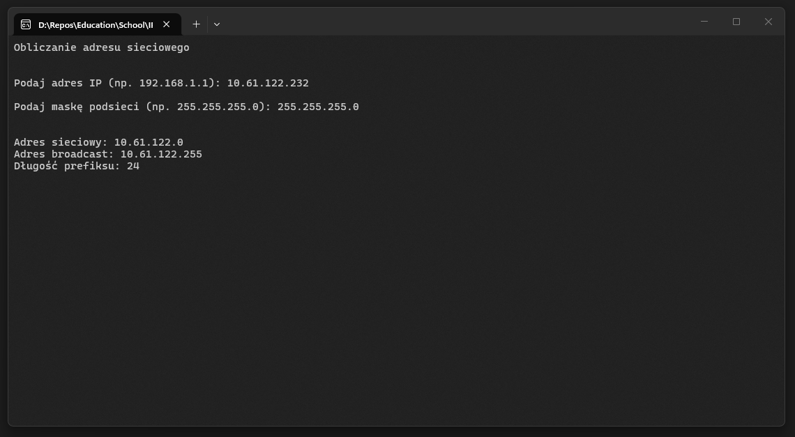
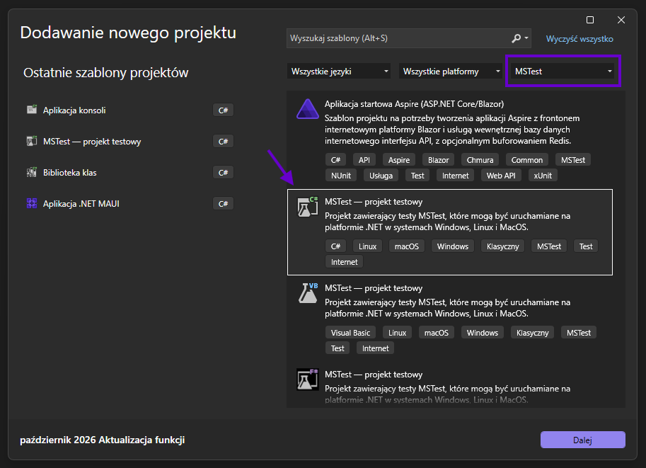
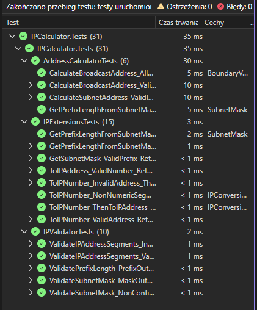

# Task 20 (1 / 2) - Kalkulator adresów IP
Pierwsza część zadania polegającego na stworzeniu prostego kalkulatora adresów IP. Na zadanie składa się napisanie biblioteki zawierającej logikę obliczania adresu sieci oraz adresu rozgłoszeniowego na podstawie adresu IP oraz maski sieci, a także pokrycie jej testami jednostkowymi.



## Wymagania
Twoim zadaniem jest stworzenie trzech projektów, które będą zawierały logikę obliczania adresów IP. Projekty powinny spełniać następujące wymagania:
 - **Biblioteka klas - Core**
    - w bibliotece znajduje się klasa statyczna będąca kalkulatorem adresów - do obliczania adresu sieci i broadcastu,
    - biblioteka posiada walidatory, które pozwalają sprawdzić czy dane wprowadzone przez użytkownika są poprawne,
    - biblioteka powinna dostarczać tak skonstruowane metody, aby z łatwością podłączać ją do kolejnych aplikacji bez konieczności rozumienia jej działania (jak biblioteki zewnętrzne).
 - **Testy jednostkowe - Tests**
    - testy jednostkowe powinny pokrywać wszystkie przypadki opisane w tej instrukcji, w tym:
        - testowanie obliczania adresów,
        - testowanie konwertowania formy zapisu adresów,
        - testowanie walidatorów w bibliotece,
 - **Tester konsolowy - Tester**
    - aplikacja konsoli pozwalająca użytkownikowi w prosty sposób przetestować działanie biblioteki *(Core)*,
    - tester powinien się zapętlać - po zakończeniu obliczeń, powinniśmy wracać na początek,
    - tester nie może implementować własnych metod obliczeniowych - może jedynie odwoływać się do biblioteki *(Core)*.

W przypadku tego zadania kluczowe jest podpięcie odpowiednich referencji między poszczególnymi projektami w rozwiązaniu - *robiliśmy to wielokrotnie*.

To zadanie ma pomóc zrozumieć Ci koncepcję **testów jednostkowych**. Nie musisz tworzyć aplikacji MAUI - wystarczy, że skupisz się na poprawnym zaimplementowaniu kalkulatora oraz napisaniu rozbudowanych testów jednostkowych.

## Wprowadzenie teoretyczne
Poniżej znajdziesz podstawowe informacje o sposobie funkcjonowania protokołu IPv4, pomogą Ci one zrozumieć ideę stojącą za sposobie w jaki komunikują się między sobą urządzenia sieciowe na warstwie trzeciej *(warstwa sieci)* w modelu **ISO/OSI**.

### Czym jest adres IP?
Każde urządzenie podłączone do sieci *(komputer, telefon, drukarka, serwer, router)* musi posiadać swój unikalny identyfikator, dzięki któremu inne urządzenia wiedzą, gdzie wysłać dane. Tym identyfikatorem jest właśnie **adres IP** *(Internet Protocol)*.

Najprościej porównać go do adresu pocztowego:
 - **część sieciowa** adresu to *ulica* - określa, w której sieci znajduje się urządzenie,
 - **część hostowa** adresu to *numer domu* - określa konkretne urządzenie *(host)* w tej sieci.

Router *(listonosz)* nie musi znać każdego domu na świecie - wystarczy, że wie, w którą ulicę skręcić. Dopiero na miejscu szukamy konkretnego numeru. Dokładnie tak działa warstwa trzecia modelu ISO/OSI: routery przekazują pakiety na podstawie **adresu sieci**, a dopiero ostatni router w łańcuchu dostarcza je do konkretnego **hosta**.

Obecnie funkcjonują dwie wersje protokołu:
 - **IPv4** - adres 32-bitowy, np. `192.168.1.10` *(ok. 4,3 mld adresów)*,
 - **IPv6** - adres 128-bitowy, np. `2001:db8::1` *(praktycznie nieskończona pula)*.

W tym zadaniu zajmujemy się **wyłącznie IPv4**.

### Budowa adresu IPv4
Adres IPv4 to w rzeczywistości **jedna liczba 32-bitowa**. Ponieważ ciąg 32 zer i jedynek jest nieczytelny dla człowieka, dzielimy go na **4 oktety** *(po 8 bitów)* i każdy z nich zapisujemy dziesiętnie, oddzielając kropką. Taki zapis nazywamy *dotted decimal*.

Jeden oktet to 8 bitów, więc może przyjmować wartości od `0` *(00000000)* do `255` *(11111111)*. Adres `192.168.1.256` jest więc **niepoprawny**, podobnie jak `192.168.1` *(3 oktety)* czy `192.168.1.1.1` *(5 oktetów)*.

#### Konwersja oktetu na postać binarną
Każdy bit w oktecie ma swoją wagę - kolejne potęgi dwójki:

| Bit   | 7     | 6    | 5    | 4    | 3   | 2   | 1   | 0   |
|-------|-------|------|------|------|-----|-----|-----|-----|
| Waga  | `128` | `64` | `32` | `16` | `8` | `4` | `2` | `1` |

Przykładowo `168 = 128 + 32 + 8`, czyli `10101000`.

Adres `192.168.1.10` w postaci binarnej wygląda następująco:

```
192      .168      .1        .10
11000000 .10101000 .00000001 .00001010
```

#### Adres jako jedna liczba
Skoro adres to 32 bity, możemy go potraktować jako zwykłą liczbę całkowitą. Pierwszy oktet jest najbardziej znaczący *(jak cyfra tysięcy w liczbie dziesiętnej)*:

$$
\text{IP} = a \cdot 2^{24} + b \cdot 2^{16} + c \cdot 2^{8} + d
$$

gdzie:
- **a, b, c, d** – kolejne oktety adresu `a.b.c.d`

Dla `192.168.1.10`:

$$
192 \cdot 16777216 + 168 \cdot 65536 + 1 \cdot 256 + 10 = 3232235786
$$

Konwersja w drugą stronę polega na "wycięciu" kolejnych 8-bitowych fragmentów liczby - za pomocą dzielenia całkowitego i reszty z dzielenia przez `256` lub *(elegancko)* przesunięć bitowych `>>` i maski `& 255`.

**Dlaczego to takie ważne?** Wszystkie obliczenia w kalkulatorze *(adres sieci, broadcast, maska)* sprowadzają się do prostych **operacji bitowych na liczbach**. Dużo łatwiej jest wykonać `a & b` na dwóch liczbach niż operować na czterech osobnych oktetach zapisanych jako tekst.

> **Uwaga** 
>
> Maksymalna wartość adresu to `255.255.255.255` = `4294967295` *(2³² - 1)*. Typ `int` w C# mieści wartości tylko do `2147483647`, więc już adres `128.0.0.0` spowoduje przepełnienie. Użyj typu całkowitego, 64-bitowego.

### Maska podsieci
Skąd wiadomo, która część adresu jest *ulicą*, a która *numerem domu*? Informację tę niesie **maska podsieci** *(subnet mask)* - również liczba 32-bitowa, która składa się z:
 - **ciągu jedynek** na początku - oznaczają one bity **części sieciowej**,
 - **ciągu zer** na końcu - oznaczają one bity **części hostowej**.

```
Adres:  11000000.10101000.00000001.00001010   (192.168.1.10)
Maska:  11111111.11111111.11111111.00000000   (255.255.255.0)
        |----- część sieciowa ----|--host--|
```

#### Zapis dziesiętny i CIDR
Maskę można zapisać na dwa sposoby:
 - **dziesiętnie** *(jak adres)*: `255.255.255.0`,
 - **w notacji CIDR** *(prefiks)*: `/24` - czyli po prostu **liczba jedynek** w masce.

Oba zapisy oznaczają dokładnie to samo. Adres z maską zapisujemy najczęściej jako `192.168.1.10/24`.

Maskę na podstawie prefiksu **n** możemy wyliczyć ze wzoru:

$$
\text{maska} = 2^{32} - 2^{32 - n}
$$

gdzie:
 - **n** – długość prefiksu *(od 0 do 32)*

Konwersja w drugą stronę *(maska -> prefiks)* to po prostu policzenie jedynek w masce.

#### Najczęściej spotykane maski

| Prefiks | Maska             | Liczba adresów | Liczba hostów |
|---------|-------------------|----------------|---------------|
| `/8`    | `255.0.0.0`       | 16 777 216     | 16 777 214    |
| `/16`   | `255.255.0.0`     | 65 536         | 65 534        |
| `/24`   | `255.255.255.0`   | 256            | 254           |
| `/25`   | `255.255.255.128` | 128            | 126           |
| `/26`   | `255.255.255.192` | 64             | 62            |
| `/27`   | `255.255.255.224` | 32             | 30            |
| `/28`   | `255.255.255.240` | 16             | 14            |
| `/29`   | `255.255.255.248` | 8              | 6             |
| `/30`   | `255.255.255.252` | 4              | 2             |
| `/31`   | `255.255.255.254` | 2              | 2 *(\*)*      |
| `/32`   | `255.255.255.255` | 1              | 1 *(\*)*      |

*(\*) przypadki szczególne - opisane niżej.*

Zauważ, że w ostatnim oktecie maski mogą pojawić się tylko wartości: `0, 128, 192, 224, 240, 248, 252, 254, 255`. Wynika to z tego, że jedynki muszą być "dosunięte" do lewej strony.

#### Poprawna i niepoprawna maska
Nie każda liczba 32-bitowa jest poprawną maską! Maska musi składać się z **nieprzerwanego ciągu jedynek, po którym następuje nieprzerwany ciąg zer**. Przykłady:

| Maska             | Postać binarna                        | Poprawna? |
|-------------------|---------------------------------------|-----------|
| `255.255.255.0`   | `11111111.11111111.11111111.00000000` | Tak        |
| `255.255.240.0`   | `11111111.11111111.11110000.00000000` | Tak        |
| `255.0.255.0`     | `11111111.00000000.11111111.00000000` | NIE *(jedynki po zerach)* |
| `255.255.255.1`   | `11111111.11111111.11111111.00000001` | NIE *(jedynka na końcu)*   |
| `0.0.0.255`       | `00000000.00000000.00000000.11111111` | NIE *(odwrócona maska)*    |

**Wskazówka:** jeżeli odwrócisz bity poprawnej maski *(operator `~`)*, otrzymasz liczbę złożoną z samych jedynek na końcu, np. `00000000.00000000.00000000.11111111`. Taka liczba ma zawsze postać **2ᵏ - 1**. Pomyśl, jaką właściwość ma liczba o postaci 2ᵏ - 1 po dodaniu do niej jedynki - i jak to sprawdzić operatorem `&`.

### Adres sieci i adres rozgłoszeniowy *(broadcast)*
Każda sieć *(podsieć)* posiada dwa specjalne adresy, których **nie można przypisać** żadnemu urządzeniu:
 - **adres sieci** *(network address)* - **pierwszy** adres w puli, wszystkie bity hosta ustawione na `0`. Identyfikuje całą sieć *(nazwa ulicy)*.
 - **adres rozgłoszeniowy** *(broadcast address)* - **ostatni** adres w puli, wszystkie bity hosta ustawione na `1`. Pakiet wysłany na ten adres trafia do **wszystkich** urządzeń w danej sieci.

Wszystkie adresy pomiędzy nimi to **adresy hostów** - możemy je przypisać urządzeniom.

#### Przypomnienie - operacje bitowe

| A | B | `A & B` *(AND)* | `A \| B` *(OR)* | `~A` *(NOT)* |
|---|---|-----------------|-----------------|--------------|
| 0 | 0 | 0               | 0               | 1            |
| 0 | 1 | 0               | 1               | 1            |
| 1 | 0 | 0               | 1               | 0            |
| 1 | 1 | 1               | 1               | 0            |

#### Wzory
**Adres sieci** - zerujemy bity hosta, zostawiając bity sieci bez zmian. Wykonujemy iloczyn bitowy adresu i maski:

$$
\text{adres sieci} = \text{IP} \ \text{AND} \ \text{maska}
$$

**Adres rozgłoszeniowy** - ustawiamy wszystkie bity hosta na `1`. Wykonujemy sumę bitową adresu i odwróconej maski:

$$
\text{broadcast} = \text{IP} \ \text{OR} \ (\text{NOT} \ \text{maska})
$$

> **Uwaga!**
>
> Jeżeli przechowujesz adres w typie `long` *(64 bity)*, operator `~` odwróci **wszystkie 64 bity**, a nie tylko 32. Wynik musisz "przyciąć" z powrotem do 32 bitów, np. `& 0xFFFFFFFF` *(lub `& uint.MaxValue`)*.

#### Przykład krok po kroku
Policzmy adres sieci i broadcast dla `192.168.10.77/26`.

Maska `/26` to 26 jedynek: `255.255.255.192`. Pierwsze trzy oktety maski to `255`, więc w nich nic się nie zmieni - skupmy się na ostatnim oktecie *(77)*:

```
IP (77):            01001101
Maska (192):        11000000
------------------------------
AND -> sieć:         01000000  = 64
~Maska:             00111111
OR  -> broadcast:    01111111  = 127
```

Wynik:
- **adres sieci:** `192.168.10.64`
- **broadcast:** `192.168.10.127`
- **pierwszy host:** `192.168.10.65` *(adres sieci + 1)*
- **ostatni host:** `192.168.10.126` *(broadcast - 1)*
- **liczba hostów:** `62`

#### Liczba adresów i hostów

$$
\text{liczba adresów} = 2^{32 - n}
$$

$$
\text{liczba hostów} = 2^{32 - n} - 2
$$

gdzie:
- **n** – długość prefiksu
- **-2** – odejmujemy adres sieci i adres rozgłoszeniowy

#### Przypadki szczególne
- **`/32`** - sieć składa się z jednego adresu. Adres sieci = broadcast = adres IP. Stosowane do oznaczenia pojedynczego hosta *(np. w tablicach routingu)*.
- **`/31`** - sieć z dwoma adresami. Zgodnie z klasycznym wzorem byłoby `0` hostów, ale w praktyce *(RFC 3021)* oba adresy wykorzystuje się na łączach punkt-punkt między dwoma routerami.
- **`/0`** - cała przestrzeń adresowa IPv4 *(`0.0.0.0/0`)*. Oznacza "dowolny adres" - np. trasę domyślną w routerze.

Twoja biblioteka powinna poprawnie obsługiwać wszystkie prefiksy od `/0` do `/32`. **Pamiętaj, aby uwzględnić je w testach jednostkowych!**

### Podsumowanie wzorów
Ściąga przydatna podczas implementacji i pisania testów jednostkowych:

| Operacja                       | Wzór                                          |
|--------------------------------|-----------------------------------------------|
| Adres `a.b.c.d` -> liczba       | `a·2²⁴ + b·2¹⁶ + c·2⁸ + d`                    |
| Prefiks `n` -> maska            | `2³² - 2³²⁻ⁿ`                                 |
| Maska -> prefiks                | liczba jedynek w masce                        |
| Adres sieci                    | `IP & maska`                                   |
| Adres rozgłoszeniowy           | `(IP \| ~maska) & 0xFFFFFFFF lub uint.MaxValue` |
| Pierwszy host                  | `adres sieci + 1`                              |
| Ostatni host                   | `broadcast - 1`                               |
| Liczba adresów                 | `2³²⁻ⁿ`                                       |
| Liczba hostów                  | `2³²⁻ⁿ - 2`                                   |

## Krok po kroku
Poniżej znajdziesz wskazówki, które pomogą Ci w realizacji zadania.

### Walidatory
Na początek zajmijmy się klasą, w której umieścimy walidatory - będą one odpowiedzialne za sprawdzanie poprawności danych wprowadzanych przez użytkownika. Walidatory najlepiej umieścić w **osobnej klasie statycznej**. Metody walidujące nie będą nic zwracały - jeżeli walidacja danych się nie powiedzie, będą **rzucały wyjątkiem**.

#### Sprawdzanie liczby segmentów w adresie IP
Jak wiemy z części teoretycznej - **adres IP oraz maska składają się z czterech oktetów** a każdy oktet ma wartość **od 0 do 255**.
```csharp
public static void ValidateIPAddressSegments(long[] segments, string ipAddress)
{
    // Sprawdzamy czy ilość segmentów się zgadza
    if (segments.Length != 4)
    {
        throw new ArgumentException($"Invalid IP address format: {ipAddress}");
    }

    // Sprawdzamy czy wartości w segmentach mieszczą się w dozwolonym zakresie
    if (segments.Any(segment => segment < 0 || segment > byte.MaxValue))
    {
        throw new ArgumentException($"Invalid IP address segment value: {ipAddress}");
    }

    // Jeżeli doszliśmy do tego miejsca, wszystko jest w porządku
}
```

#### Sprawdzanie poprawności maski (prefix)
Tutaj sprawa jest jeszcze prostsza - musimy sprawdzić, czy zapis prefiksowy maski mieści się w przedziale od `0` do `32`.

#### Sprawdzanie poprawności maski (pełna liczba)
Maksymalna wartość maski w IPv4 to `0xFFFFFFFF` lub `UInt32.MaxValue` - ta walidacja może być nieco trudniejsza, przez konieczność zastosowania operatorów logicznych.
```csharp
public static void ValidateSubnetMask(long subnetMask)
{
    if (subnetMask < 0 || subnetMask > UInt32.MaxValue)
    {
        throw new ArgumentOutOfRangeException(nameof(subnetMask), "Subnet mask must be a valid 32-bit unsigned integer.");
    }

    // Bity hosta poprawnej maski to same jedynki na końcu (np. 0.0.0.255),
    // więc po dodaniu 1 nie mogą mieć żadnego wspólnego bitu z wynikiem.
    long hostBits = ~subnetMask & UInt32.MaxValue;
    if ((hostBits & (hostBits + 1)) != 0)
    {
        throw new ArgumentException("Subnet mask must consist of contiguous leading ones.", nameof(subnetMask));
    }
}
```

### Konwersja wartości
Adres IP wprowadzany przez użytkownika będzie w formie `a.b.c.d` - ciężko, żeby ktoś wprowadzał wartość IP jako liczbę całkowitą, stąd będziemy musieli przygotować metody umożliwiającą dwustronną konwersję zapisu - na stringu przecież nie wykonamy operacji logicznych ani przesunięcia bitów... **prawda?**

#### Konwertowanie zapisu na postać dziesiętną
Z wprowadzenia wiemy, że adres IP da się zapisać jako zwykłą (*choć dość dużą*) liczbę dziesiętną, na której będziemy mogli wykonywać operacje logiczne oraz przesunięcia bitów.
```csharp
public static long ToIPNumber(this string ipAddress)
{
    var segments = // Dzielimy otrzymany adres IP na segmenty, i parsujemy do odpowiedniego typu
    // można od razu dokonać projekcji do kolekcji lub tablicy

    // Walidacja - po coś w końcu robiliśmy te walidatory
    IPValidator.ValidateIPAddressSegments(segments, ipAddress);

    return (segments[0] << 24) | (segments[1] << 16) // [...] pozostałe segmenty również musimy przesunąć
}
```

#### Kowertowanie zapisu na postać oktetową (czytelną)
Jeżeli użytkownikowi wyświetlimy ogromną liczbę całkowitą, nie będzie on wiedział jaki wyszedł nam adres IP z obliczeń - *chyba że potrafi rozwiązywać ogromne logarytmy binarne w pamięci*. Po obliczeniu danego adresu, wynik musimy skonwertować na postać, która będzie zrozumiała dla użytkownika.
```csharp
public static string ToIPAddress(this long ipNumber)
{
    var segmentA = (ipNumber >> 24) & 255; // <-- przesuwamy liczbę o 24 bity w prawo (niszczymy pierwsze 24 bity)
    var segmentB = ... // Niszczymy pierwszych 16 bitów
    var segmentC = ... // itd.
    var segmentD = ... // itp.

    // Zwracamy postać oktetową
    return $"{segmentA}.{segmentB}.{segmentC}.{segmentD}";
}
```

#### Obliczanie maski sieci z postaci postfixowej
Maskę sieci użytkownik może chcieć podać w notacji postfixowej (np. `/24`), podobnie jak adres IP chcemy to przeliczyć do pełnej liczby dziesiętnej.
```csharp
public static long GetSubnetMask(this int prefixLength)
{
    // Nie zapominamy o walidacji
    IPValidator.ValidatePrefixLength(prefixLength);

    return ... // <-- tutaj odwołujemy się do wcześniej podanego wzoru
}
```

Żebyś nie musiał/a szukać, chodzi o [ten wzór](#zapis-dziesiętny-i-cidr).

> **Uwaga**
>
> Dobrze tutaj pomyśleć o stworzeniu własnej metody do potęgowania, dlatego że domyślna (`Math.Pow`) operuje na **liczbach zmiennoprzecinkowych podwójnej precyzji**. Jest to typ wystarczająco duży do zwrócenia poprawnego wyniku, jednakże znacznie cięższy dla procesora oraz mniej dokładny niż typ odpowiednio dużej liczby całkowitej.

#### Obliczanie notacji postfixowej maski z liczby dziesiętnej
Podobnie jak w przypadku adresu IP, zwracając użytkownikowi maskę zapisaną jako ogromna liczba całkowita, nie będzie on wiedział o co chodzi ani co z tym zrobić. Porządny kalkulator adresów IP powinien potrafić wyświetlić użytkownikowi również zapis skrócony (postfixowy).
```csharp
public static int GetPrefixLengthFromSubnetMask(this long subnetMask)
{
    // Na pewno dobrze będzie na początku uruchomić odpowiedni walidator...

    int prefixLength = 0;
    for (int i = 31; i >= 0; i--)
    {
        if ((subnetMask & (1L << i)) != 0) // <-- tutaj algorytm jest trochę trudniejszy
        {
            // Chodzi o to, że przechodzimy po każdym z bitów maski, sprawdzając kiedy się kończy - kończy się, kiedy zostaną same zera.
            prefixLength++;
        }

        else
        {
            break;
        }
    }

    return prefixLength;
}
```

#### Inne konwersje
Być może uznasz, że potrzebne będą także inne metody do konwersji, **droga wolna!** Nie zapomnij jednak, aby każdą z tych metod pokryć testami jednostkowymi.

### Metody pomocnicze - matematyka
Jak już wspomniałem w jednym z poprzednich punktów, dobrze będzie napisać sobie przynajmniej jedną metodę pomocniczą - do matmy!

#### Potęgowanie 64-bitowych liczb całkowitych
Napisanie takiej metody jest **banalnie proste**, ale powinniśmy ją odpowiednio zabezpieczyć... Najlepiej też pokryć testami jednostkowymi!
```csharp
 public static long Pow(this int baseValue, int exponent) // <-- Extension method, pamiętasz co to było? Na pewno tak!
 {
     // Zakładamy, że metoda nie przyjmuje wykładników mniejszych od zera
     // if (zero) throw...

     // Elegancko mnożymy daną liczbę w pętli
     // [...]

     return result;
 }
```

**Pamiętaj, że** każda liczba podniesiona do potęgi zerowej daje jeden.

Jeżeli nie chcesz, nie musisz tworzyć nowej metody do potęgowania liczb całkowitych, możesz użyć tej istniejącej i operować na liczbach zmiennoprzecinkowych, jednakże musisz wtedy być świadomy możliwych zagrożeń płynących z zastosowania takiego rozwiązania.

## Testy jednostkowe
Kiedy już zaimplementowałeś niezbędne funkcje w bibliotece klas, możemy przejść do pisania testów jednostkowych, które pomogą Ci sprawdzić, czy Twój kod działa poprawnie.

Poniżej znajdziesz **listę przypadków testowych wraz z danymi** - samą treść testów *(Arrange, Act, Assert)* napiszesz już samodzielnie, na podstawie prezentacji z zajęć. Na poniższej liście znajduje się **absolutne minimum** - jeżeli przyjdzie Ci do głowy inny ciekawy przypadek, śmiało go dopisz.

### Przygotowanie projektu z testami
 - Dodaj do rozwiązania projekt **MSTest** o nazwie `IPCalculator.Tests` i podepnij w nim referencję do `IPCalculator.Core`.
 - Dla każdej klasy z biblioteki stwórz **osobną klasę testową** *(np. `AddressCalculator` -> `AddressCalculatorTests`)*. Dobrze jest umieścić je w folderze `Tests`.
 - Każda klasa testowa musi być oznaczona atrybutem `[TestClass]`, a każdy test atrybutem `[TestMethod]`.
 - Nazwy testów zapisuj według schematu z prezentacji: **`Metoda_Przypadek_OczekiwanyRezultat`**, np. `GetSubnetMask_PrefixOutOfRange_ThrowsArgumentOutOfRangeException`.



### Zanim zaczniesz - kilka pułapek
#### Typ `long` w atrybucie `[DataRow]`
Wartości przekazywane w `[DataRow(...)]` muszą mieć **dokładnie taki typ, jak parametr metody testowej**. Liczba `0` to dla kompilatora `int`, a nie `long` - jeżeli parametr jest typu `long`, dopisz do liczby przyrostek `L`:

```csharp
[DataRow(0, 0L)]                // prefiks (int), maska (long)
[DataRow(24, 4294967040L)]      // 255.255.255.0
```

Duże liczby *(adresy IP)* zapisuj w testach jako liczby dziesiętne, a obok w komentarzu dodaj ich czytelną postać - za tydzień (*lub dwa*) nie będziesz pamiętać, czym było `3232235786L`.

#### `ThrowsExactly` sprawdza **dokładny** typ wyjątku
`ArgumentOutOfRangeException` dziedziczy po `ArgumentException`. Jeżeli metoda rzuci `ArgumentOutOfRangeException`, a test oczekuje `ArgumentException` *(lub odwrotnie)*, test **nie przejdzie**. Pilnuj więc, który wyjątek rzuca która metoda - w tabelach poniżej oczekiwany wyjątek jest zawsze podany.

| Sytuacja                                              | Oczekiwany wyjątek             |
|-------------------------------------------------------|--------------------------------|
| zła liczba oktetów lub oktet spoza `0 – 255`          | `ArgumentException`            |
| oktet nie jest liczbą *(np. `"a.b.c.d"`)*             | `FormatException`              |
| prefiks spoza `0 – 32`                                | `ArgumentOutOfRangeException`  |
| maska spoza zakresu `0 – UInt32.MaxValue`             | `ArgumentOutOfRangeException`  |
| maska z nieciągłymi jedynkami                         | `ArgumentException`            |

**Dla uproszczenia** nie musisz tworzyć własnych wyjątków, użyjemy wyjątków dostępnych bezpośrednio wewnątrz platformy .NET.

#### Test bez asercji
Walidatory nic nie zwracają - albo rzucają wyjątek, albo nie. Jak więc sprawdzić, że poprawne dane **przechodzą** walidację? Wystarczy wywołać walidator w teście **bez żadnej asercji**. Jeżeli metoda testowa rzuci nieobsłużony wyjątek - test kończy się niepowodzeniem. Jeżeli dojdzie do końca - test przechodzi.

#### Tablice w `[DataRow]`
Do `[DataRow(...)]` możesz przekazać tablicę, ale **nie listę** *(`List<T>` nie jest stałą, więc nie może być argumentem atrybutu)*. Przyda się to przy testowaniu `ValidateIPAddressSegments`, która przyjmuje tablicę segmentów.

Poniższy przykład łączy obie pułapki - tablicę w `[DataRow]` oraz test bez asercji:

```csharp
[TestMethod]
[DataRow(new long[] { 0, 0, 0, 0 })]
[DataRow(new long[] { 255, 255, 255, 255 })]
public void ValidateIPAddressSegments_ValidSegments_DoesNotThrow(long[] segments)
{
    IPValidator.ValidateIPAddressSegments(segments, string.Join('.', segments));

    // Nie ma potrzeby asercji, jeżeli nie zostanie tutaj wyrzucony wyjątek - test przechodzi
}
```

### Testy klasy `IPValidator` - `IPValidatorTests`
#### `ValidateIPAddressSegments`
Metoda przyjmuje tablicę segmentów oraz tekst adresu *(używany w komunikacie wyjątku)* - tekst możesz zbudować z segmentów, np. `string.Join('.', segments)`.

| Test                                                                | Segmenty                 | Oczekiwany rezultat |
|---------------------------------------------------------------------|--------------------------|---------------------|
| `ValidateIPAddressSegments_ValidSegments_DoesNotThrow`              | `{ 0, 0, 0, 0 }`         | brak wyjątku        |
|                                                                     | `{ 255, 255, 255, 255 }` | brak wyjątku        |
| `ValidateIPAddressSegments_InvalidSegments_ThrowsArgumentException` | `{ 1, 2, 3 }`            | `ArgumentException` |
|                                                                     | `{ 256, 1, 1, 1 }`       | `ArgumentException` |

#### `ValidatePrefixLength`

| Test                                                                      | Prefiks | Oczekiwany rezultat           |
|---------------------------------------------------------------------------|---------|-------------------------------|
| `ValidatePrefixLength_PrefixOutOfRange_ThrowsArgumentOutOfRangeException` | `-1`    | `ArgumentOutOfRangeException` |
|                                                                           | `33`    | `ArgumentOutOfRangeException` |

#### `ValidateSubnetMask`
Zwróć uwagę, że ta metoda rzuca **dwa różne wyjątki** - w zależności od tego, co jest nie tak z maską.

| Test                                                                  | Maska *(liczba)* | Maska *(czytelnie)*   | Oczekiwany rezultat           |
|-----------------------------------------------------------------------|------------------|-----------------------|-------------------------------|
| `ValidateSubnetMask_MaskOutOfRange_ThrowsArgumentOutOfRangeException` | `-1`             | -                     | `ArgumentOutOfRangeException` |
|                                                                       | `4294967296`     | `UInt32.MaxValue + 1` | `ArgumentOutOfRangeException` |
| `ValidateSubnetMask_NonContiguousMask_ThrowsArgumentException`        | `4278255360`     | `255.0.255.0`         | `ArgumentException`           |
|                                                                       | `4294967041`     | `255.255.255.1`       | `ArgumentException`           |

### Testy klasy `IPExtensions` - `IPExtensionsTests`
Tutaj testujemy metody rozszerzające - w teście wywołujemy je na wartości, np. `ipNumber.ToIPAddress()` czy `24.GetSubnetMask()`.

> **Uwaga**
>
> Zwróć uwagę, że `.ToIPAddress()` oraz `.ToIPNumber()` to metody rozszerzeń - przynajmniej w kodzie z instrukcji.

#### `ToIPAddress` i `ToIPNumber`

| Test                                                | Dane wejściowe      | Oczekiwany rezultat |
|-----------------------------------------------------|---------------------|---------------------|
| `ToIPAddress_ValidNumber_ReturnsDottedNotation`     | `0`                 | `"0.0.0.0"`         |
|                                                     | `3232235777`        | `"192.168.1.1"`     |
| `ToIPNumber_ValidAddress_ReturnsNumber`             | `"255.255.255.255"` | `4294967295`        |
|                                                     | `"192.168.1.1"`     | `3232235777`        |
| `ToIPNumber_InvalidAddress_ThrowsArgumentException` | `"1.2.3"`           | `ArgumentException` |
|                                                     | `"256.1.1.1"`       | `ArgumentException` |

Kolejne dwa testy nie potrzebują `[DataRow]` - każdy sprawdza tylko jedną wartość, więc dane wpisz bezpośrednio w części **Arrange**:

| Test                                                    | Dane wejściowe   | Oczekiwany rezultat                     |
|---------------------------------------------------------|------------------|-----------------------------------------|
| `ToIPNumber_NonNumericSegment_ThrowsFormatException`    | `"a.b.c.d"`      | `FormatException`                       |
| `ToIPNumber_ThenToIPAddress_ReturnsOriginalAddress`     | `"172.16.254.1"` | `"172.16.254.1"` *(identyczny tekst)*   |

Drugi z nich sprawdza, czy obie konwersje są swoimi **odwrotnościami** - zamieniamy tekst na liczbę, a liczbę z powrotem na tekst. Wynik musi być identyczny z danymi wejściowymi.

#### `GetSubnetMask`
Wynik metody to liczba - żeby test był czytelniejszy, porównaj go po konwersji na tekst *(`ToIPAddress()`)*.

| Test                                           | Prefiks | Oczekiwany rezultat |
|------------------------------------------------|---------|---------------------|
| `GetSubnetMask_ValidPrefix_ReturnsCorrectMask` | `0`     | `"0.0.0.0"`         |
|                                                | `24`    | `"255.255.255.0"`   |
|                                                | `26`    | `"255.255.255.192"` |
|                                                | `32`    | `"255.255.255.255"` |

**Wskazówka:** w prezentacji znajdziesz tabelę z jeszcze ciekawszymi przypadkami - `/7` i `/9` *(okolice granicy oktetu)*. Warto je dopisać!

#### `GetPrefixLengthFromSubnetMask`
Tym razem dane wejściowe podaj jako tekst i skonwertuj je w teście *(`ToIPNumber()`)*.

| Test                                                                      | Maska             | Oczekiwany rezultat |
|---------------------------------------------------------------------------|-------------------|---------------------|
| `GetPrefixLengthFromSubnetMask_ValidMask_ReturnsCorrectPrefix`            | `"0.0.0.0"`       | `0`                 |
|                                                                           | `"255.255.255.0"` | `24`                |
| `GetPrefixLengthFromSubnetMask_NonContiguousMask_ThrowsArgumentException` | `"255.0.255.0"`   | `ArgumentException` |

> **Uwaga!**
>
> W teście `NonContiguousMask` pamiętaj, aby konwersję `ToIPNumber()` wykonać **przed** `Assert.ThrowsExactly` *(w części Arrange)* - inaczej nie będziesz mieć pewności, która metoda rzuciła wyjątek.

### Testy klasy `AddressCalculator` - `AddressCalculatorTests`
#### Test w pętli - wszystkie prefiksy
Kilka wierszy `[DataRow]` to nie wszystko - prefiksów jest **33**. Zamiast pisać 33 wiersze, możemy sprawdzić wszystkie w pętli. Napisz test, który dla każdego prefiksu od `/0` do `/32` oblicza maskę, a następnie z maski z powrotem prefiks - wynik musi być równy prefiksowi, od którego zaczęliśmy:

**Nazwa testu:** `GetPrefixLengthFromSubnetMask_AllPrefixes_RoundTripsWithGetSubnetMask`

```csharp
[TestMethod]
public void GetPrefixLengthFromSubnetMask_AllPrefixes_RoundTripsWithGetSubnetMask()
{
    for (int prefixLength = 0; prefixLength <= 32; prefixLength++)
    {
        long subnetMask = AddressCalculator.GetSubnetMask(prefixLength);

        // Asercja: czy prefiks obliczony z maski jest równy prefixLength?
        // Wskazówka: do asercji możesz dodać komunikat, np. $"Prefix /{prefixLength}",
        // dzięki czemu od razu zobaczysz, dla którego prefiksu test się wysypał.
        Assert.AreEqual(prefixLength, AddressCalculator.GetPrefixLengthFromSubnetMask(subnetMask), $"Prefix /{prefixLength}");
    }
}
```

#### `CalculateSubnetAddress` i `CalculateBroadcastAddress`
Testy przyjmują adres IP *(liczba)* oraz **prefiks** - maskę oblicz w teście za pomocą `GetSubnetMask` *(Arrange)*. Drugi wiersz to [przykład z części teoretycznej](#przykład-krok-po-kroku).

| Test                                                           | Adres IP                       | Prefiks | Oczekiwany rezultat             |
|----------------------------------------------------------------|--------------------------------|---------|---------------------------------|
| `CalculateSubnetAddress_ValidInput_ReturnsNetworkAddress`      | `3232235786` *(192.168.1.10)*  | `24`    | `3232235776` *(192.168.1.0)*    |
|                                                                | `3232238157` *(192.168.10.77)* | `26`    | `3232238144` *(192.168.10.64)*  |
| `CalculateBroadcastAddress_ValidInput_ReturnsBroadcastAddress` | `3232235786` *(192.168.1.10)*  | `24`    | `3232236031` *(192.168.1.255)*  |
|                                                                | `3232238157` *(192.168.10.77)* | `26`    | `3232238207` *(192.168.10.127)* |

#### Broadcast zawsze mieści się w 32 bitach
Pamiętasz [ostrzeżenie](#wzory) o operatorze `~` na typie `long`? Ten test sprawdza, czy o nim nie zapomniałeś/aś. Dla stałego adresu `192.168.1.10` *(`3232235786`)* i **każdego** prefiksu od `/0` do `/32` oblicz broadcast i sprawdź, czy wynik mieści się w zakresie od `0` do `UInt32.MaxValue`.

**Nazwa testu:** `CalculateBroadcastAddress_AllPrefixes_ResultFitsIn32Bits`

```csharp
[TestMethod]
public void CalculateBroadcastAddress_AllPrefixes_ResultFitsIn32Bits()
{
    long ipAddress = 3232235786L;   // 192.168.1.10

    for (int prefixLength = 0; prefixLength <= 32; prefixLength++)
    {
        long subnetMask = AddressCalculator.GetSubnetMask(prefixLength);
        long actual = // [...] obliczamy broadcast

        // Asercja: czy actual jest >= 0 i <= UInt32.MaxValue?
        // Nie mamy tu jednej oczekiwanej wartości - sprawdzamy WARUNEK.
        // Która z asercji z prezentacji sprawdza, czy warunek jest prawdziwy?
    }
}
```

**Zastanów się,** dlaczego wartość ujemna oznacza błąd? Co by się stało, gdybyś przy obliczaniu broadcastu zapomniał/a "przyciąć" wynik do 32 bitów?

### Uruchamianie testów
Testy uruchom przez **Eksplorator testów** *(Test -> Eksplorator testów)*. Jeżeli wszystko zrobiłeś/aś poprawnie, wszystkie testy powinny być zielone.



## Konsolowy tester
Pracując nad algorytmami, które wymagają dość dużej precyzji, dobrą praktyką jest **stworzenie prostej aplikacji konsolowej**, która będzie pozwalała przetestować działanie biblioteki **na poprawnych danych**. Tester nie jest zamiennikiem testów automatycznych, jest jedynie dopełniemem, które pozwala przetestować na własne oczy działanie algorytmu.

### Tester powinien się zapętlać
Tester ma tylko jedno zadanie - obliczanie adresu sieci i adresu rozgłoszeniowego - więc nie potrzebuje rozbudowanego menu. Wystarczy pętla, która po każdym obliczeniu wraca na początek.
```csharp
private static void Main()
{
    // Najprostszy sposób na zapętlenie aplikacji konsolowej
    while (true)
    {
        CalculateNetworkAddress();
    }
}
```

**Zauważ, że** tester nie posiada żadnej obsługi błędów - nie potrzebujemy jej tutaj. Jeżeli użytkownik wprowadzi niepoprawne dane, aplikacja się po prostu wysypie - jest to zachowanie jak najbardziej dopuszczalne.

### Proste obliczanie adresu sieci
Chcemy aby nasz tester maksymalnie prosto pozwalał na przetestowanie obliczania adresu sieci i adresu rozgłoszeniowego.
```csharp
private static void CalculateNetworkAddress()
{
    Console.Clear();
    Console.WriteLine("Obliczanie adresu sieciowego\r\n\r\n");
    Console.Write("Podaj adres IP (np. 192.168.1.1): ");
    var ipAddress = Console.ReadLine();
    Console.WriteLine();

    Console.Write("Podaj maskę podsieci (np. 255.255.255.0): ");
    var subnetMask = Console.ReadLine();
    Console.WriteLine("\r\n");
    
    var subnetAddress = AddressCalculator.CalculateSubnetAddress(ipAddress.ToIPNumber(), subnetMask.ToIPNumber());
    var broadcastAddress = AddressCalculator.CalculateBroadcastAddress(ipAddress.ToIPNumber(), subnetMask.ToIPNumber());
    var prefixLength = AddressCalculator.GetPrefixLengthFromSubnetMask(subnetMask.ToIPNumber());

    Console.WriteLine($"Adres sieciowy: {subnetAddress.ToIPAddress()}");
    Console.WriteLine($"Adres broadcast: {broadcastAddress.ToIPAddress()}");
    Console.WriteLine($"Długość prefiksu: {prefixLength}");
    Console.ReadLine();
}
```

## Kryteria oceny
Zadanie jest podzielone na części - **ocenę** otrzymasz za finalny efekt (*będzie się na nią wliczała zarówno część pierwsza, jak i kolejna*). Poniżej znajdziesz kryteria oceny, które będą tyczyły tej części.


